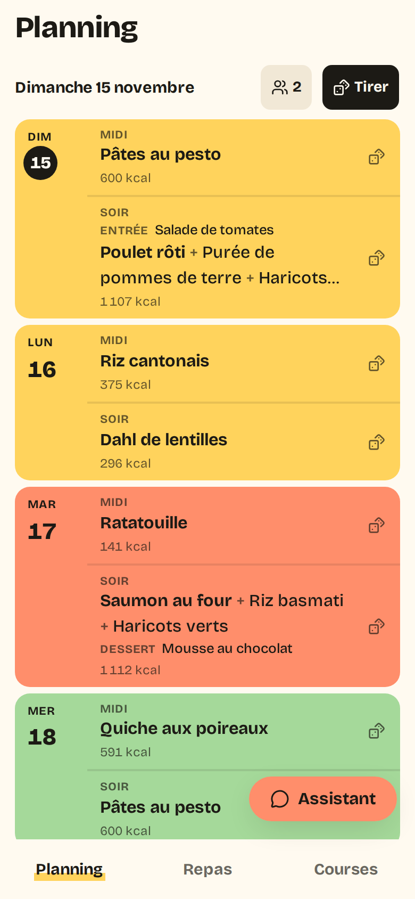
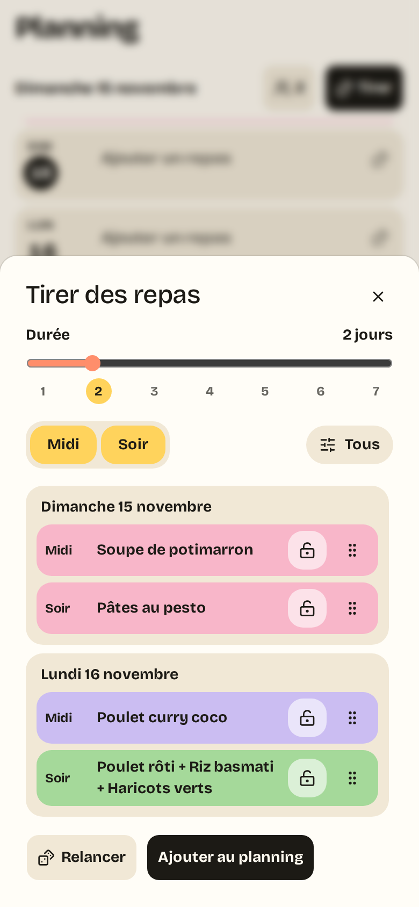
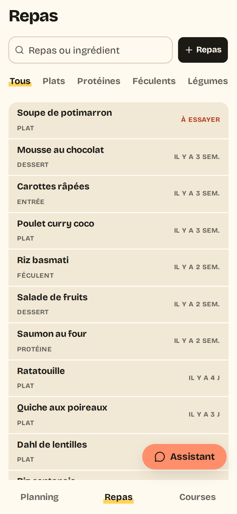
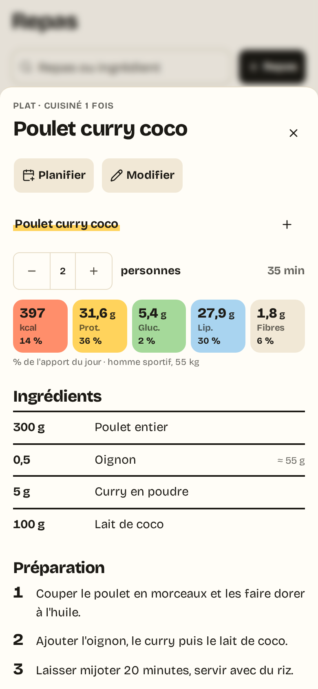
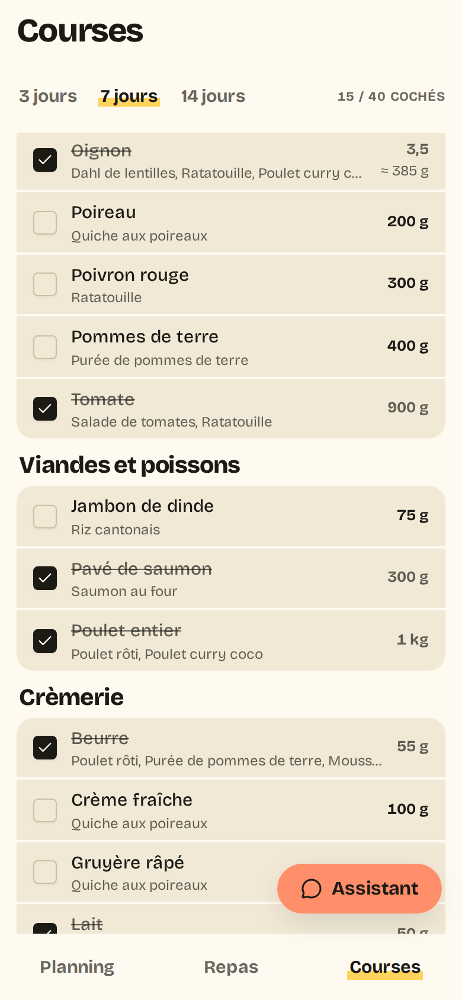
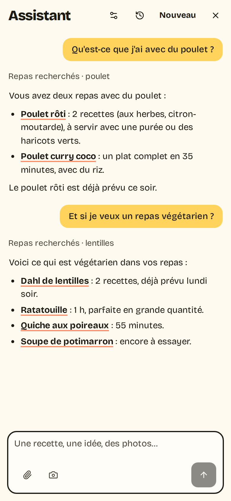
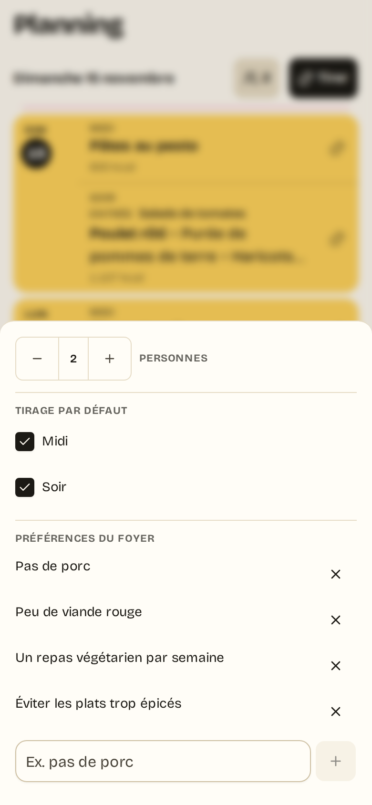

# Meal planner

A self-hosted meal planner for a household: a recipe library, a rolling meal plan, a shopping list, nutrition figures, and a chat assistant that can operate the app.

The interface and all content are in French. It is built for one family running it on a home server and reaching it from their phones over Tailscale or a local network. It is a single Bun process with a SQLite file, so idle memory use stays low. It is phone-first and can be installed on a home screen as a PWA. The chat assistant is optional and works by calling the same services as the UI, through tools.

## Screenshots

<table>
  <tr>
    <td align="center"><br>Planning</td>
    <td align="center"><br>Tirer</td>
    <td align="center"><br>Repas</td>
    <td align="center"><br>Recette</td>
  </tr>
  <tr>
    <td align="center"><br>Courses</td>
    <td align="center"><br>Assistant</td>
    <td align="center"><br>Foyer</td>
    <td></td>
  </tr>
</table>

## Features

- **Planning**: a rolling plan starting today, with lunch and dinner slots. A slot holds entrée, plat and dessert courses.
- **Meal library**: meals with one or more recipes, a default recipe, and quantities scaled to the number of people.
- **Tirer (draw game)**: a short card game to fill the coming days, alone or with the other household members, each on their phone or passing one phone. Tapping Tirer deals cards at once (balanced on protein and fibre); each player secretly picks one card per empty slot, cards picked by both are matches, and a catch-up round lets each accept the other's remaining picks. Only meals both accepted are planned; extra matches go to a small "envies communes" reserve that comes back in later hands. Each hand has a ✨ Nouveau card (a dish never made). Changing the duration adapts the hand. A quick mode deals fast meals for tonight, and the dice on a slot offers three cards to pick from.
- **Shopping list**: for the next 3, 7 or 14 days, grouped by aisle, with ticks and manual lines.
- **Nutrition**: per-person values from the Ciqual table, an extended detail view, and daily references for a 55 kg active young man (indicative, not medical advice).
- **Search**: by meal name or ingredient, with ingredient exclusion ("with chicken but without rice").
- **Household preferences**: free-text notes that the assistant takes into account.
- **Live updates**: changes appear on the household's other devices through server-sent events (SSE).
- **PWA**: installable from the browser to the home screen. There is no offline mode.
- **Assistant**: a chat that creates and edits meals, recipes and ingredients, plans slots, draws, builds shopping lists and searches the web. It runs on Claude (Claude Agent SDK) or Codex, chosen in the app. It accepts up to 6 photos per message. Runs are owned by the server and continue if the phone leaves. Conversation history is shared across devices.

## Requirements

- [Bun](https://bun.sh) 1.4.x (developed and tested with 1.4.4). There is no `engines` field in `package.json`.
- Network access for the one-time Ciqual download.
- Optional, for the assistant, one of:
  - Claude: a logged-in Claude Code on the machine, or `ANTHROPIC_API_KEY` set. Without the key the Agent SDK uses the machine's Claude login.
  - Codex: `@openai/codex-sdk` is used, so Codex must be set up and signed in on the machine. The repository does not configure this for you.

Without either, the planner, library, draw and shopping list work normally; only the chat does not.

## Quick start

```sh
git clone https://github.com/Hugo-AOYAGI/meal-planner.git
cd meal-planner
bun install
bun run seed:ciqual    # download the Ciqual table and import it (idempotent)
bun run build          # builds the web app into dist/
bun run start          # http://127.0.0.1:4173 (API and built web app)
```

`seed:ciqual` downloads the ANSES Ciqual 2025 spreadsheet to `data/ciqual/ciqual-2025.xlsx`, imports the foods into the database, and refreshes the detail values of ingredients that have a Ciqual code. It is needed for nutrition lookups and ingredient matching; re-running it is safe.

For development, `bun run dev` starts the API with `--watch` (port 4173) and Vite (port 5173, proxying `/api`).

## Configuration

Environment variables read by the code:

| Variable | Default | Purpose |
|---|---|---|
| `PORT` | `4173` | HTTP port. The server always listens on `127.0.0.1`. |
| `DB_PATH` | `data/meal-planner.db` | SQLite file. `:memory:` is used by the tests. |
| `MEAL_PLANNER_MODEL` | `claude-sonnet-5-5` | Model used by the Claude assistant. |
| `MEAL_PLANNER_CODEX_MODEL` | `gpt-6.1-terra` | Model used by the Codex assistant. |
| `ANTHROPIC_API_KEY` | unset | If set, the Claude assistant bills the API; otherwise it uses the machine's Claude login. |
| `MEAL_PLANNER_BACKGROUND` | on | `off` disables the assistant's background jobs (recipe durations for the quick draw, new-dish ideas for the draw), which otherwise run 5 minutes after start and every night at 03:30. |

The assistant, household size (default servings, default 2), which moments the draw fills (default dinner), the draw's players and the quick draw's time limit (default 25 min) are set in the app, under the Foyer settings, and stored in the database.

## Data and backups

Everything lives in `data/`, which is gitignored: the SQLite database (`data/meal-planner.db`, WAL mode, `synchronous=FULL`), the Ciqual download, and the assistant's working files. Migrations are applied automatically at startup.

The server backs itself up: around 03:00 local time every night it writes `data/backups/<date>.db` with `VACUUM INTO` and keeps the last 7. To restore, stop the service and copy a backup over `data/meal-planner.db`. For a manual backup while the service runs:

```sh
sqlite3 data/meal-planner.db "VACUUM INTO '/path/to/backup.db'"
```

## Deployment

The server binds to loopback only, so reaching it from other devices needs a proxy such as `tailscale serve`. A systemd user unit is provided in `deploy/meal-planner.service`. It expects the repository at `~/meal-planner` and Bun at `~/.bun/bin/bun`; edit the paths if yours differ.

```sh
bun install && bun run seed:ciqual && bun run build
mkdir -p ~/.config/systemd/user && cp deploy/meal-planner.service ~/.config/systemd/user/
systemctl --user daemon-reload && systemctl --user enable --now meal-planner
loginctl enable-linger "$USER"      # start at boot without a login session
```

Share it on your tailnet over HTTPS:

```sh
tailscale serve --bg 4173
# then open https://<machine>.<tailnet>.ts.net on your devices
```

The unit file has commented-out `ANTHROPIC_API_KEY` and `MEAL_PLANNER_MODEL` lines for the assistant.

**There is no authentication.** Anyone who can reach the port can read and change all data and use the assistant. Keep it on a private network (Tailscale or LAN) and do not expose it to the public internet, including with `tailscale funnel`.

## Using the app

The interface has three tabs and a chat.

- **Planning**: days from today, each with a midi (lunch) and soir (dinner) slot. Open a slot to pick meals, choose a recipe, set servings and add a starter or dessert. Use **Tirer** to draw meals for empty slots: choose what to fill, look at the proposals, lock the ones you like, and apply. The dice on a day re-rolls that day. The **Foyer** button holds household size, which moments the draw fills, the assistant choice and preferences.
- **Repas**: the meal library. Search by name or ingredient, add words to exclude, open a meal to see recipes, scaled quantities and nutrition, and edit them. A meal can be marked "à essayer" (to try).
- **Courses**: the shopping list for 3, 7 or 14 days, summed from the plan and grouped by aisle. Tick items off and add your own lines.
- **Assistant**: the chat panel. Example prompts (in French, as the assistant answers in French):
  - `Ajoute une recette de dahl de lentilles corail pour 4 personnes.`
  - `Qu'est-ce que j'ai avec du poulet mais sans riz ?`
  - `Retiens que Léa n'aime pas les champignons.`
  - `Fais la liste de courses pour les 3 prochains jours.`
  - `Remplis les dîners de la semaine avec des repas que je n'ai pas mangés depuis longtemps.`
  - Attach a photo of a recipe (a cookbook page, a screenshot) and ask `Ajoute cette recette.`

Install as an app:

- **iPhone (Safari)**: open the HTTPS address, tap Share, then "Add to Home Screen".
- **Android (Chrome)**: open the HTTPS address, open the menu, then "Install app" or "Add to Home screen".

## Development

```
src/shared/    zod schemas, constants, date and nutrition helpers shared by server and client
src/server/    Hono app, Drizzle schema and migrations, services, routes, agent, backup, Ciqual seed
  agent/       chat route, system prompt, tools, Claude and Codex runtimes
  services/    domain logic: calc (draw, balance, shopping sums), catalog, planning, support
src/client/    React app: components (shadcn/ui), features (week, meals, shopping, chat), lib
tests/         bun test suites
scripts/       check-structure.ts
deploy/        systemd user unit
docs/          design spec and Agent SDK notes
public/        PWA manifest and icons
```

The server exposes a typed Hono API consumed by the client through the Hono RPC client. Routes and assistant tools are thin wrappers over the same service functions and zod schemas. Database access goes through `bun:sqlite` with Drizzle.

```sh
bun run test              # bun test, against an in-memory database
bun run typecheck         # tsc --noEmit
bun run check:structure   # layout rules, see below
bun run db:generate       # drizzle-kit generate
```

`check:structure` scans `src/` and `tests/` and fails if a directory holds more than 5 files or a file exceeds 250 lines. Drizzle-generated migrations are excluded.

After changing `src/server/db/schema.ts`, run `bun run db:generate` (same as `bunx drizzle-kit generate`) and commit the new migration. It is applied at the next startup.

**Stack**: Bun, Hono with its RPC client, Drizzle ORM on `bun:sqlite`, zod, Vite, React 19, Tailwind CSS v4, shadcn/ui, TanStack Query, Vercel AI SDK on the chat client, Claude Agent SDK and Codex SDK for the assistant.

More detail: [design spec](docs/superpowers/specs/2026-11-14-meal-planner-design.md) and [Agent SDK notes](docs/agent-sdk-notes.md).

## Data credits

Nutrition values come from the [Ciqual French food composition table](https://ciqual.anses.fr) published by ANSES, released under the Licence Ouverte / Etalab 2.0 ([dataset DOI 10.57745/RDMHWY](https://doi.org/10.57745/RDMHWY)). The data is downloaded at install time by `seed:ciqual` and is not redistributed in this repository.

Daily reference intakes in the app are indicative values for a young, active man of 55 kg, based on ANSES references (fibre, salt, minerals, vitamins, fatty acids) and sports nutrition guidance (energy, protein, carbohydrates). They are not medical advice. See `src/shared/nutrition-targets.ts`.

## License

MIT. See [LICENSE](LICENSE).
